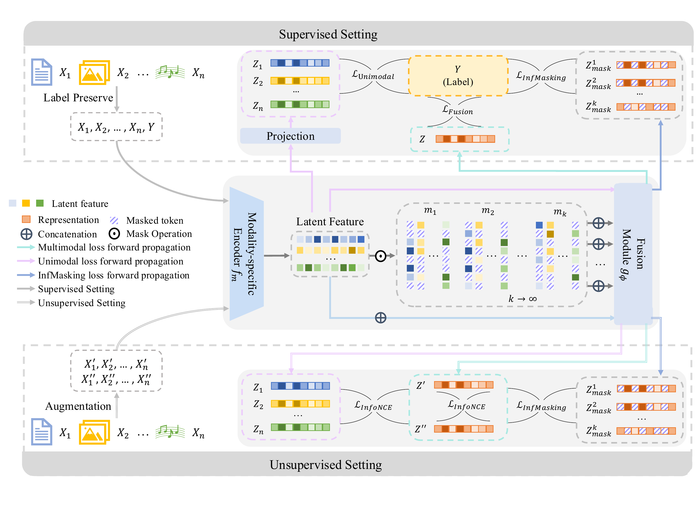

<h1 align="center">InfMasking: A Unified Variational Framework for Synergistic Multimodal Learning</h1>

<p align="center">
  Liangjian Wen, Qun Dai, Jiang Duan, Yong Dai, Jianzhuang Liu, Dongkai Wang, Jun Wang, Fuyuan Cao, Zenglin Xu, Zhao Kang
</p>

<p align="center">
  Accepted by IEEE Transactions on Pattern Analysis and Machine Intelligence (TPAMI), 2026.
</p>

**Paper:** [DOI: 10.1109/TPAMI.2026.3751348](https://doi.org/10.1109/TPAMI.2026.3751348)

This directory contains the **supervised experiments** for the TPAMI 2026 journal extension of our **NeurIPS 2025 Spotlight** paper, [InfMasking: Unleashing Synergistic Information by Contrastive Multimodal Interactions](https://arxiv.org/abs/2509.25270). It provides experiments on **MOSI, MOSEI, MIMIC, MAMI and MUTE**. The original unsupervised implementation and conference results are documented in the [root README](../README.md).

## Overview

InfMasking unifies unsupervised representation learning and supervised multimodal collaboration through **Infinite Masking**. It repeatedly masks modality-specific feature tokens before fusion to learn from diverse partial observations. The reference target is the unmasked fused view in unsupervised learning and the class proxy of the task label in supervised learning.

In this supervised implementation, fused and unimodal classification losses are combined with a label-proxy InfMasking objective over masked fused representations. The paper derives a tractable variational upper bound for the supervised objective under a Gaussian model of masked fusion states.

<p align="center">
  
</p>

The diagram shows the supervised setting at the top and the unsupervised setting at the bottom. The experiments in this directory use the supervised setting.

### Extensions over the Conference Version

The TPAMI paper extends the NeurIPS 2025 work with:

1. A unified formulation covering unsupervised and supervised learning, including a label-proxy masked fusion objective.
2. A Gaussian-based variational upper bound for the supervised objective.
3. Covariance-controlled tightness guarantees for both unsupervised and supervised bounds under the Gaussian model, Monte Carlo evaluation of surrogate gaps, and analysis of conditions beyond Gaussianity.
4. Broader supervised validation, including benchmark comparisons, ablations, robustness evaluation, PID estimates and InterSHAP interaction analysis.

## Training and Evaluation

### Installation

```bash
cd TPAMI2026
conda env create -f environment.yml
conda activate sup-infmasking
```

The environment uses Python 3.10, PyTorch 2.1.0. All dependencies are specified in `environment.yml`.

### Data Preparation

Prepare MOSI, MOSEI and MIMIC following [MultiBench](https://github.com/pliang279/MultiBench). Prepare MAMI and MUTE following the [MultiBench++ dataset instructions](https://github.com/Han-Zongbo/MultiBenchplus/blob/main/DATASET.md).

To use an external data directory:

```bash
export TPAMI_DATA_ROOT=/path/to/data
```

As in the root InfMasking implementation, dataset locations are configured in `dataset/catalog.json`. You can set absolute paths directly in the catalog. Relative data paths are resolved under `TPAMI_DATA_ROOT`, which defaults to `TPAMI2026/data/`.

The loaders expect the following prepared files under that data root:

| Dataset | Files |
| --- | --- |
| MOSI | `mosi/mosi_data.pkl` |
| MOSEI | `mosei/mosei_senti_data.pkl` |
| MIMIC | `mimic/im.pk` (authorized MultiBench preprocessing; task 7) |
| MAMI | `mami/{train,validation,test}.tsv`, `mami/training_images/`, `mami/test_images/` |
| MUTE | `mute/{train,valid,test}_hate.xlsx`, `mute/Memes/` |

MAMI TSV files must contain `file_name`, `text` and binary `label` columns. MUTE workbooks must have a header row followed by image filename, caption and label in the first three columns; labels are `not-hate` and `hate`. Dataset files and pretrained weights are not included.

### Pretrained Models

MAMI and MUTE use **`bert-base-uncased`** and **ResNet-152 (`IMAGENET1K_V2`)**. Both backbones are fine-tuned.

Place the BERT model and tokenizer files in `pretrained/bert-base-uncased/`, or set:

```bash
export TPAMI_BERT_MODEL=/path/to/bert-base-uncased
```

You can also set `bert_model_path` for MAMI and MUTE in `dataset/catalog.json`. Local paths beginning with `pretrained/`, `./` or `../` are resolved relative to `TPAMI2026/`; absolute paths and Hugging Face model identifiers are supported. The `--bert-model` option overrides `TPAMI_BERT_MODEL`, which overrides the catalog. The tokenizer and BERT encoder use the same resolved model.

ResNet-152 weights are loaded through torchvision and downloaded to its cache if absent. Set `TORCH_HOME` to change that cache location.

### Run one dataset

```bash
python scripts/run_experiment.py --dataset mosi --device cuda:0
```

The default seeds are **1, 11 and 111**. To run a single seed:

```bash
python scripts/run_experiment.py --dataset mosi --seeds 1 --device cuda:0
```

Supported datasets: `mosi`, `mosei`, `mimic`, `mami`, `mute`.

Use `--num-workers 0` to load data in the main process, or select another worker count. Without this option, MultiBench uses 4 workers and MAMI/MUTE use 8. Add `--dry-run` to print the generated command without starting training.

### Run all datasets

```bash
bash scripts/run_all.sh --device cuda:0
```

The script runs the five datasets sequentially. Use `--seeds 1` to select one seed.

### Outputs

Each run saves its resolved configuration, command, training/validation logs and `ckpt/best.pth` under `outputs/<dataset>/`. Set `--output-root` or `TPAMI_OUTPUT_ROOT` to use another location. Training reloads the checkpoint with the highest validation accuracy and evaluates it on the test split; test accuracy is written to `ckpt/best.txt`.

## Citation

If you use these supervised experiments, please cite the journal paper:

```bibtex
@ARTICLE{11780635,
  author={Wen, Liangjian and Dai, Qun and Duan, Jiang and Dai, Yong and Liu, Jianzhuang and Wang, Dongkai and Wang, Jun and Cao, Fuyuan and Xu, Zenglin and Kang, Zhao},
  journal={IEEE Transactions on Pattern Analysis and Machine Intelligence}, 
  title={InfMasking: A Unified Variational Framework for Synergistic Multimodal Learning}, 
  year={2026},
  volume={},
  number={},
  pages={1-16},
  keywords={Modeling;Learning (artificial intelligence);Labeling;Training;Fuses;Accuracy;Educational institutions;Joints;Modules (abstract algebra);Entropy;Multimodal learning;multimodal fusion;synergistic information;self-supervised learning;modality collaboration;masking},
  doi={10.1109/TPAMI.2026.3751348}
}
```

The conference version's citation is available in the [root README](../README.md#citation).

## Acknowledgments

This directory extends our [NeurIPS 2025 InfMasking implementation](../README.md) with supervised experiments for the TPAMI journal paper.

We thank the authors and contributors of [MultiBench](https://github.com/pliang279/MultiBench) and [MultiBench++](https://github.com/Han-Zongbo/MultiBenchplus) for their open-source benchmarks, data preparation resources and data loaders.

Reference implementations for the supervised baselines and InterSHAP analysis used in the paper can be found in the following open-source projects:

| Baseline / analysis tool | Reference implementation |
| --- | --- |
| Vanilla MT | [RollingQ](https://github.com/GeWu-Lab/RollingQ_ICML2025/tree/check) |
| MulT | [Multimodal Transformer](https://github.com/yaohungt/Multimodal-Transformer) |
| MBT | [RollingQ](https://github.com/GeWu-Lab/RollingQ_ICML2025/tree/check) |
| JMT | [Joint Multimodal Transformer](https://github.com/PoloWlg/Joint-Multimodal-Transformer-6th-ABAW) |
| MMML | [MMML](https://github.com/zehuiwu/MMML) |
| MultiMAE-inspired | [MultiMAE](https://github.com/EPFL-VILAB/MultiMAE) |
| DCP-inspired | [DCP](https://github.com/XLearning-SCU/2022-TPAMI-DCP) |
| InterSHAP | [InterSHAP](https://github.com/LauraWenderoth/InterSHAP) |

The MultiMAE-inspired and DCP-inspired baselines adapt the original methods to our supervised experimental protocol; the links above point to the original implementations.

We thank the authors and contributors of these excellent open-source projects for sharing their implementations.
